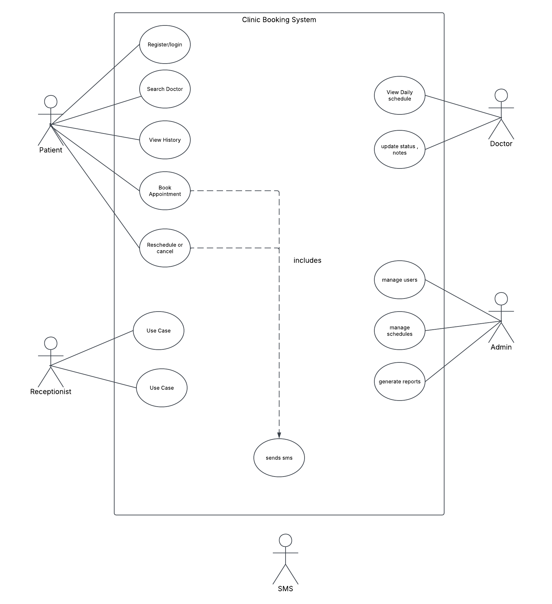

# Requirements Document

**Project Title:** Clinic Booking System with SMS/Email Notification
**Course:** Systems Integration and Architecture 1 (IT 118), BSIT 3rd Year
**Group Name:** Nonchalant group
**Members:**

| Name | Role |
|---|---|
| [Member 1] | Frontend Developer |
| [Member 2] | Backend Developer |
| [Member 3] | Database Manager |
| [Member 4] | GitHub Manager and Tester |

**Instructor:** [Instructor Name]
**Version:** 1.0
**Date:** [Date]

---

## Table of Contents

1. Introduction
2. System Description
3. Stakeholders and Users
4. Functional Requirements
5. Non-Functional Requirements
6. Integration Requirements
7. Use Case Diagram and Descriptions
8. Scope, Constraints, and Assumptions
9. Proposed Technology Stack
10. Glossary

---

## 1. Introduction

### 1.1 Purpose

This document defines the requirements for the Clinic Booking System. It describes what the system must do, who will use it, which external services it integrates with, and the quality standards it must meet. It serves as the basis for the design, development, and testing phases of the project.

### 1.2 Problem Statement

Many small clinics still handle appointments through walk-ins, phone calls, or paper logbooks. This leads to long waiting lines, double-booked time slots, missed appointments, and extra workload for clinic staff. Patients have no easy way to check a doctor's availability or to be reminded of their schedule.

### 1.3 Objectives

1. Allow patients to book, reschedule, and cancel appointments online.
2. Prevent double booking of doctor time slots.
3. Reduce no-shows through automatic SMS and email confirmations and reminders.
4. Give staff, doctors, and the administrator the tools to manage schedules, queues, and reports.
5. Demonstrate the integration of a web frontend, a backend API, a database, and external notification services.

### 1.4 Definitions and Abbreviations

| Term | Meaning |
|---|---|
| FR | Functional requirement |
| NFR | Non-functional requirement |
| API | Application Programming Interface |
| JWT | JSON Web Token, used for login sessions |
| MERN | MongoDB, Express.js, React, Node.js |
| RBAC | Role-based access control |
| SMS | Short Message Service |

---

## 2. System Description

### 2.1 Overview

The Clinic Booking System is a web-based application that lets patients register, browse doctors and available time slots, and book appointments. When an appointment is booked, changed, or cancelled, the system automatically sends an SMS or email notification. It also sends reminders before the appointment date. Clinic staff manage walk-in bookings and the daily queue, doctors view their schedules and update appointment statuses, and the administrator manages users, schedules, and reports.

### 2.2 System Context

The system consists of the following integrated components:

| Component | Description |
|---|---|
| Frontend | React web application (responsive, works on desktop and mobile browsers) |
| Backend | Node.js and Express REST API handling authentication, booking logic, and scheduling |
| Database | MongoDB (Atlas or local) storing users, doctors, appointments, blocked dates, and notification logs |
| SMS service | External SMS API (Semaphore or Twilio) for confirmations and reminders |
| Email service | Nodemailer with SMTP (Gmail or SendGrid) for confirmations, reminders, and password reset |
| Scheduler | `node-cron` job that triggers reminders at set intervals |

### 2.3 Major Features

1. User registration, login, and role-based access
2. Doctor search by specialty and availability
3. Appointment booking with double-booking prevention
4. Rescheduling and cancellation with a cutoff rule
5. Walk-in booking and queue management by staff
6. Doctor schedule management and blocked dates
7. Automatic SMS and email notifications and reminders
8. Visit status updates and basic visit notes
9. Admin dashboard and reports

---

## 3. Stakeholders and Users

### 3.1 Users

| User role | Description | Main needs |
|---|---|---|
| Patient | A person who books clinic visits | Register, find doctors, book, reschedule, cancel, view history, receive reminders |
| Receptionist / Staff | Front-desk personnel | Book walk-ins, check in patients, manage the daily queue, confirm or edit appointments |
| Doctor | Clinic physician | View the daily schedule, mark appointments as completed or no-show, add visit notes |
| Administrator | System manager | Manage users, doctor schedules, blocked dates, and view reports |

### 3.2 Other Stakeholders

| Stakeholder | Interest |
|---|---|
| Clinic owner | Fewer no-shows, better efficiency, access to reports |
| SMS provider | Receives and delivers message requests through its API |
| Email provider | Receives and delivers email through SMTP or API |
| Course instructor | Evaluates the project against the course requirements |
| Development team | Designs, builds, tests, and documents the system |

---

## 4. Functional Requirements

Priority levels: **High** (must have for the demo), **Medium** (should have), **Low** (nice to have).

### 4.1 Authentication and Account Management

| ID | Requirement | Priority |
|---|---|---|
| FR-01 | The system shall allow patients to register with name, email, phone number, and password. | High |
| FR-02 | The system shall allow users to log in using email and password. | High |
| FR-03 | The system shall support four roles: patient, staff, doctor, and admin. | High |
| FR-04 | The system shall restrict pages and API endpoints based on the user's role. | High |
| FR-05 | The system shall allow users to reset a forgotten password through an email link. | Medium |
| FR-06 | The system shall allow users to view and edit their own profile. | Medium |
| FR-07 | The admin shall be able to create, edit, deactivate, and delete user accounts, including doctor and staff accounts. | High |

### 4.2 Doctor Search and Scheduling

| ID | Requirement | Priority |
|---|---|---|
| FR-08 | The system shall list doctors with their specialty and available days. | High |
| FR-09 | The system shall allow patients to filter doctors by specialty. | Medium |
| FR-10 | The admin or staff shall be able to set each doctor's working days, working hours, and slot duration. | High |
| FR-11 | The admin or staff shall be able to block dates (holidays, leave) for a doctor. | High |
| FR-12 | The system shall generate available time slots from the doctor's schedule, excluding blocked dates and already booked slots. | High |

### 4.3 Appointment Booking

| ID | Requirement | Priority |
|---|---|---|
| FR-13 | The system shall allow a logged-in patient to book an available time slot with a doctor. | High |
| FR-14 | The system shall prevent two appointments from being booked for the same doctor, date, and time slot. | High |
| FR-15 | The system shall allow patients to reschedule an appointment, subject to the cancellation cutoff (24 hours before the appointment). | High |
| FR-16 | The system shall allow patients to cancel an appointment, subject to the same cutoff. | High |
| FR-17 | The system shall allow staff to book, reschedule, or cancel appointments on behalf of walk-in or phone patients. | High |
| FR-18 | The system shall allow patients to view their upcoming and past appointments. | High |
| FR-19 | The system shall assign statuses to appointments: Pending, Confirmed, Checked-in, Completed, Cancelled, and No-show. | High |

### 4.4 Queue and Visit Management

| ID | Requirement | Priority |
|---|---|---|
| FR-20 | Staff shall be able to view all appointments for a selected day and check in arriving patients. | High |
| FR-21 | Doctors shall be able to view their own daily schedule and patient list. | High |
| FR-22 | Doctors shall be able to mark an appointment as Completed or No-show. | High |
| FR-23 | Doctors shall be able to add brief visit notes to a completed appointment. | Medium |

### 4.5 Notifications (Integration)

| ID | Requirement | Priority |
|---|---|---|
| FR-24 | The system shall send an SMS and/or email confirmation when an appointment is booked. | High |
| FR-25 | The system shall send a notification when an appointment is rescheduled or cancelled. | High |
| FR-26 | The system shall automatically send reminders 24 hours before the appointment, and optionally 2 hours before. | High |
| FR-27 | If SMS delivery fails, the system shall fall back to email and record the failure. | Medium |
| FR-28 | The system shall keep a log of every notification with its type, channel, and delivery status. | Medium |

### 4.6 Administration and Reports

| ID | Requirement | Priority |
|---|---|---|
| FR-29 | The admin shall be able to view a dashboard with the number of appointments for the day, week, and month. | Medium |
| FR-30 | The admin shall be able to generate reports on daily appointments, no-show rate, and appointments per doctor. | Medium |
| FR-31 | The admin shall be able to view the notification log. | Low |

---

## 5. Non-Functional Requirements

| ID | Category | Requirement |
|---|---|---|
| NFR-01 | Performance | Pages shall load within 3 seconds under normal conditions, and API responses for common actions shall return within 2 seconds. |
| NFR-02 | Performance | The system shall support at least 50 concurrent users. |
| NFR-03 | Security | Passwords shall be hashed (bcrypt) and never stored or returned in plain text. |
| NFR-04 | Security | Login sessions shall use JWT with an expiry time. Protected endpoints shall verify the token and the user's role. |
| NFR-05 | Security | All user input shall be validated and sanitized to protect against NoSQL injection and cross-site scripting (XSS). |
| NFR-06 | Security | The deployed system shall use HTTPS. API keys and secrets shall be stored in environment variables, not in source code. |
| NFR-07 | Privacy | Patient data shall only be accessible to authorized roles, in line with the Data Privacy Act of 2012 (Republic Act 10173). A patient may only see their own records. |
| NFR-08 | Availability | The system shall be available at least 99% of the time during clinic hours. |
| NFR-09 | Reliability | A failed notification shall not block or roll back a successful booking. Failures shall be logged. |
| NFR-10 | Data integrity | Double booking shall be prevented at the database level using a unique compound index, not only in application code. |
| NFR-11 | Usability | The interface shall be responsive and usable on mobile screens. A patient shall be able to book an appointment in no more than 5 steps from the dashboard. |
| NFR-12 | Usability | Error messages shall be clear and tell the user what to do next. |
| NFR-13 | Scalability | The design shall allow adding more doctors, and later more branches, without restructuring the database. |
| NFR-14 | Maintainability | Code shall be modular (routes, controllers, models, services), and API endpoints shall be documented. |
| NFR-15 | Compatibility | The frontend shall work on the latest versions of Chrome, Firefox, and Edge. |
| NFR-16 | Recoverability | The database shall be backed up (for example with `mongodump`) before the demo, and the backup shall be restorable. |

---

## 6. Integration Requirements

The system integrates multiple components that exchange data with each other.

| ID | Integration | Description | Data exchanged |
|---|---|---|---|
| INT-01 | React frontend and Express API | The frontend calls REST endpoints over HTTP using JSON. | Login credentials, booking requests, appointment lists |
| INT-02 | Express API and MongoDB | The API reads and writes data through Mongoose models. | Users, doctors, appointments, blocked dates, logs |
| INT-03 | Express API and SMS API (Semaphore or Twilio) | The API sends a request to the SMS provider when a notification is triggered. | Recipient number, message text, delivery response |
| INT-04 | Express API and email service (Nodemailer with SMTP) | The API sends emails for confirmations, reminders, and password reset. | Recipient email, subject, body, delivery response |
| INT-05 | Scheduler (`node-cron`) and notification services | A scheduled job finds upcoming appointments and triggers reminders. | Appointment details, reminder status |

Optional integrations, if time allows: Google Calendar API (add the appointment to a calendar) and PayMongo (reservation fee).

---

## 7. Use Case Diagram and Descriptions

### 7.1 Use Case Diagram

*Insert the exported diagram here. File location: `docs/01-requirements/use-case-diagram.png`.*

**Actors:** Patient, Receptionist, Doctor, Admin, SMS/Email Service (external).

**Include relationships:** *Book Appointment* includes *Send SMS / Email*. *Reschedule / Cancel* includes *Send SMS / Email*.

### 7.2 Use Case Summary

| ID | Use case | Primary actor |
|---|---|---|
| UC-01 | Book Appointment | Patient |
| UC-02 | Reschedule / Cancel Appointment | Patient |
| UC-03 | Manage Doctor Schedules | Admin |
| UC-04 | Send Reminder | System scheduler |
| UC-05 | Register / Log In | Patient |
| UC-06 | Search Doctors | Patient |
| UC-07 | View Appointment History | Patient |
| UC-08 | Book Walk-in | Receptionist |
| UC-09 | Check In Patient | Receptionist |
| UC-10 | View Daily Schedule | Doctor |
| UC-11 | Update Status and Visit Notes | Doctor |
| UC-12 | Manage Users | Admin |
| UC-13 | Generate Reports | Admin |

### 7.3 Detailed Use Case Descriptions

#### UC-01: Book Appointment

| Field | Description |
|---|---|
| **Primary actor** | Patient |
| **Secondary actor** | SMS/Email service |
| **Description** | A patient reserves an available time slot with a doctor. |
| **Precondition** | The patient is registered and logged in. The doctor has a published schedule. |
| **Main flow** | 1. Patient selects a specialty or doctor. 2. System shows the doctor's available dates. 3. Patient picks a date. 4. System shows open time slots. 5. Patient selects a slot and confirms. 6. System checks the slot is still free and saves the appointment as Confirmed. 7. System sends an SMS/email confirmation. |
| **Alternate flow** | 6a. The slot was taken by another user: the system shows the next available slots. 7a. SMS delivery fails: the system sends email instead and logs the failure. |
| **Postcondition** | The appointment is saved, the slot is unavailable to others, and a notification record is created. |

#### UC-02: Reschedule / Cancel Appointment

| Field | Description |
|---|---|
| **Primary actor** | Patient |
| **Secondary actor** | SMS/Email service |
| **Description** | A patient changes the date or time of an appointment, or cancels it. |
| **Precondition** | The patient is logged in and has an appointment with status Confirmed. |
| **Main flow** | 1. Patient opens "My Appointments". 2. Patient selects an appointment and chooses Reschedule or Cancel. 3. System checks the cutoff rule (at least 24 hours before the appointment). 4. For rescheduling, the patient selects a new slot. 5. System updates the appointment and releases the old slot. 6. System sends a notification. |
| **Alternate flow** | 3a. The appointment is within the cutoff: the system blocks the change and advises the patient to contact the clinic. 4a. The new slot is taken: the system shows other available slots. |
| **Postcondition** | The appointment is updated or marked Cancelled, and the old slot becomes available. |

#### UC-03: Manage Doctor Schedules

| Field | Description |
|---|---|
| **Primary actor** | Admin |
| **Description** | The admin defines a doctor's working days, hours, slot duration, and blocked dates. |
| **Precondition** | The admin is logged in and the doctor account exists. |
| **Main flow** | 1. Admin selects a doctor. 2. Admin sets working days, working hours, and slot duration. 3. Admin adds blocked dates, if any. 4. System validates and saves the schedule. 5. System generates available slots from the new schedule. |
| **Alternate flow** | 3a. A blocked date already has booked appointments: the system lists them and asks the admin to reschedule or notify those patients first. |
| **Postcondition** | The schedule is saved and patients see only valid slots. |

#### UC-04: Send Reminder

| Field | Description |
|---|---|
| **Primary actor** | System scheduler |
| **Secondary actor** | SMS/Email service |
| **Description** | The system automatically reminds patients of upcoming appointments. |
| **Precondition** | A confirmed appointment falls within the reminder window (24 hours or 2 hours ahead) and has no reminder sent yet. |
| **Main flow** | 1. The scheduled job runs at its set interval. 2. System queries upcoming confirmed appointments without a reminder. 3. System sends an SMS (or email) to each patient. 4. System records the result in the notification log. |
| **Alternate flow** | 3a. The SMS API returns an error: the system falls back to email, logs the failure, and retries once. |
| **Postcondition** | Each reminder is logged as sent or failed, and appointments are marked as reminded. |

#### Other Use Cases (brief)

| ID | Use case | Description |
|---|---|---|
| UC-05 | Register / Log In | A user creates an account or signs in with email and password. The system issues a JWT and redirects to the role's dashboard. |
| UC-06 | Search Doctors | A patient filters doctors by specialty and views availability. |
| UC-07 | View Appointment History | A patient views upcoming and past appointments and their statuses. |
| UC-08 | Book Walk-in | A receptionist books an appointment on behalf of a walk-in or phone patient. |
| UC-09 | Check In Patient | A receptionist marks a patient as arrived so the doctor sees them in the queue. |
| UC-10 | View Daily Schedule | A doctor views the day's appointments in time order. |
| UC-11 | Update Status and Visit Notes | A doctor marks an appointment Completed or No-show and adds brief notes. |
| UC-12 | Manage Users | The admin creates, edits, or deactivates user accounts. |
| UC-13 | Generate Reports | The admin views reports on daily appointments, no-show rate, and appointments per doctor. |

---

## 8. Scope, Constraints, and Assumptions

### 8.1 In Scope

- User registration, login, and role-based access
- Doctor schedule setup and slot generation
- Appointment booking, rescheduling, cancellation, and walk-in booking
- Doctor daily schedule and visit status updates
- SMS and email confirmations and reminders
- Basic admin dashboard and reports

### 8.2 Out of Scope

- Electronic medical records (beyond brief visit notes)
- Billing, insurance, and online payment (optional future work)
- Telemedicine or video consultation
- Multi-branch support
- Native mobile application (the web app is responsive instead)

### 8.3 Constraints

- The project must be completed within the 5-week course timeline.
- The system must use at least one frontend, one backend with a database, and one integration component, with basic authentication.
- The team is limited to free or low-cost services (MongoDB Atlas free tier, Nodemailer with a Gmail account, and an SMS provider's trial or low-cost credits).
- SMS delivery depends on a third-party provider and on the available credits.

### 8.4 Assumptions

- The clinic has a single branch.
- Every patient has a mobile number or an email address.
- Doctors' schedules follow a regular weekly pattern, with exceptions entered as blocked dates.
- Appointments use fixed-length slots (for example 30 minutes).
- Users have internet access and a modern web browser.

### 8.5 Business Rules

1. A time slot can have only one active appointment.
2. Patients can only reschedule or cancel at least 24 hours before the appointment.
3. A patient can only view and manage their own appointments.
4. Only a doctor can mark an appointment as Completed or add visit notes.
5. Only admin or staff can change doctor schedules.

---

## 9. Proposed Technology Stack

The full justification will be provided in `docs/02-design/tech-stack-justification.md`. A summary:

| Layer | Technology | Reason |
|---|---|---|
| Frontend | React, React Router, Axios | Component-based UI, large community, easy API integration |
| Backend | Node.js, Express | JavaScript across the whole stack, quick REST API development |
| Database | MongoDB with Mongoose | Flexible schema, unique compound indexes for double-booking prevention, free Atlas tier |
| Authentication | JWT, bcryptjs | Stateless sessions and secure password hashing |
| SMS | Semaphore or Twilio API | Reliable SMS delivery, simple REST integration |
| Email | Nodemailer | Free and easy SMTP integration |
| Scheduler | node-cron | Lightweight reminder jobs inside the Node server |
| Testing | Jest, Supertest, Postman | API and integration testing |
| Version control | Git and GitHub | Team collaboration, pull requests, issue tracking |

---

## 10. Glossary

| Term | Definition |
|---|---|
| Appointment slot | A fixed block of time in a doctor's schedule that can be booked by one patient |
| Blocked date | A date on which a doctor is unavailable (holiday, leave) |
| Walk-in | A patient who comes to the clinic without a prior online booking |
| No-show | A patient who does not attend a confirmed appointment |
| Reminder | An automatic SMS or email sent before an appointment |
| Notification log | A record of every message sent by the system and its delivery result |

---

*End of document.*
